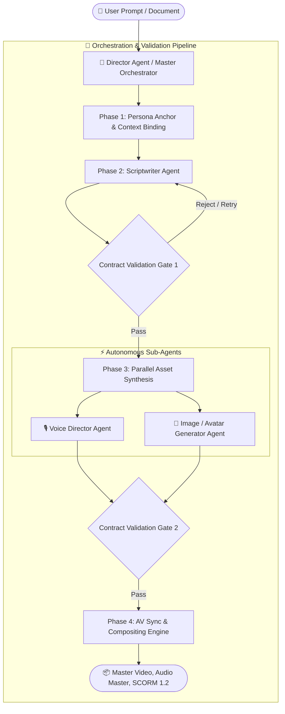
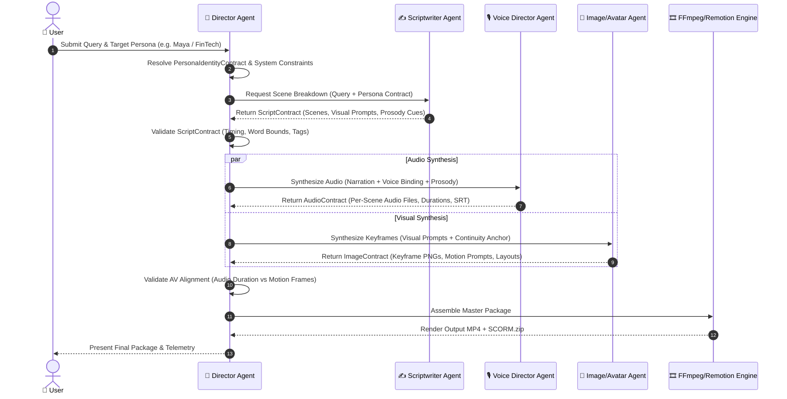
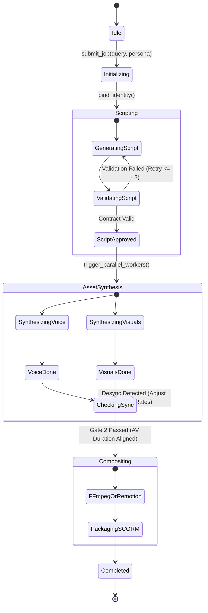

# 🎬 Multi-Agent Orchestration Architecture: Director-Led Autonomous Studio

## 1. Executive Architecture Overview

In traditional generative video pipelines, passing raw user prompts directly to Text-to-Speech (TTS) or image generation models leads to three critical failure modes:
1. **Unstructured Narrative Flow**: Raw text lacks scene timing, emotional pacing, visual cues, and natural speech pauses.
2. **Persona Drift & Cultural Mismatches**: Visual avatars frequently drift across scenes, or worse, get paired with incompatible voice accents (e.g., an Indian corporate persona voiced by a Midwestern American accent).
3. **Pacing Desynchronization**: Audio length mismatches visual keyframe duration, leading to awkward freezes or cropped narrations.

To eliminate these issues, this architecture introduces a **Hierarchical Multi-Agent Topology** governed by a **Director Agent (Leader)** coordinating three specialized workers:
1. **Scriptwriter Agent**: Transforms raw queries/documents into pedagogical, multi-scene scripts with stage directions.
2. **Voice Director Agent**: Synthesizes neural audio matching the character persona's vocal identity and script prosody.
3. **Image / Avatar Generator Agent**: Synthesizes identity-locked keyframes, continuity anchors, and avatar overlays.



---

## 2. Persona Consistency & Context Schema (`PersonaIdentityContract`)

To guarantee strict audio-visual alignment, the **Director Agent enforces an immutable `PersonaIdentityContract`** across all downstream agents. Sub-agents cannot pick arbitrary models, voices, or styles; they must resolve all generation parameters through this shared identity anchor.

### Unified Persona Metadata Schema

```python
from enum import Enum
from typing import List, Optional, Dict, Any
from pydantic import BaseModel, Field

class GenderEnum(str, Enum):
    FEMALE = "female"
    MALE = "male"
    NON_BINARY = "non_binary"

class RegionLocaleEnum(str, Enum):
    EN_IN = "en-IN"   # South Asian / Indian English
    EN_US = "en-US"   # North American English
    EN_GB = "en-GB"   # British English
    TE_IN = "te-IN"   # Telugu
    TA_IN = "ta-IN"   # Tamil
    HI_IN = "hi-IN"   # Hindi
    ES_ES = "es-ES"   # Castilian Spanish
    FR_FR = "fr-FR"   # French
    DE_DE = "de-DE"   # German
    JA_JP = "ja-JP"   # Japanese

class PersonaIdentityContract(BaseModel):
    """
    Immutable identity anchor distributed to all sub-agents to ensure AV harmony.
    """
    persona_id: str = Field(..., description="Unique key, e.g., 'maya_fintech'")
    display_name: str = Field(..., description="Human-readable presenter name")
    gender: GenderEnum
    target_locale: RegionLocaleEnum
    demographic_ethnicity: str = Field(..., description="E.g., 'South Asian', 'Nordic', 'East Asian'")
    industry_domain: str = Field(..., description="E.g., 'FinTech', 'Enterprise AI', 'HealthCare'")
    visual_continuity_anchor: str = Field(
        ...,
        description="Immutable negative/positive prompt tokens describing facial structure, wardrobe, and styling."
    )
    voice_binding: Dict[str, Any] = Field(
        ...,
        description="Strict voice profiles for Edge-TTS and ElevenLabs mapping to this demographic."
    )
    default_pitch: str = "+0Hz"
    default_speed: float = 1.0
    recommended_art_style: str = "Photorealistic 8K (Corporate / Tech)"
```

### Certified Pre-Baked Identity Catalog

| Persona ID | Presenter | Demographics & Ethnicity | Locale Binding | Voice Profiles (Edge / ElevenLabs) | Visual Anchor Tokens |
| :--- | :--- | :--- | :--- | :--- | :--- |
| **`maya_fintech`** | Maya | South Asian Female (30yo) | `en-IN` / `hi-IN` | `en-IN-NeerjaNeural` / `Rachel` (Pitch: `+1Hz`) | `30yo South Asian female corporate executive, tailored navy blazer, modern trading floor backdrop, photorealistic 8k` |
| **`alex_ai`** | Alex | Caucasian Male (35yo) | `en-US` | `en-US-GuyNeural` / `Adam` (Pitch: `-2Hz`) | `35yo male enterprise AI architect with sleek glasses, charcoal minimalist tech blazer, server room command center` |
| **`elena_risk`** | Elena | Hispanic/Latina Female (38yo) | `es-ES` / `en-US` | `es-ES-ElviraNeural` / `Bella` (Pitch: `+0Hz`) | `38yo Latina governance and legal director, cream blazer, modern boardroom, warm natural lighting` |
| **`rajesh_cloud`** | Rajesh | South Asian Male (40yo) | `en-IN` / `te-IN` | `en-IN-PrabhatNeural` / `Josh` (Pitch: `-1Hz`) | `40yo South Asian cloud architect, subtle salt-and-pepper hair, formal sky blue shirt, glass whiteboard` |

---

## 3. Sub-Agent Roles, Responsibilities & I/O Contracts



---

### 3.1 ✍️ Scriptwriter Agent

- **Role**: Ingests the raw topic or uploaded document (`.txt`, `.md`, `.srt`), structures the pedagogical outline, splits the curriculum into 1–16 logical scene chunks, and writes both the spoken narration and visual prompts.
- **Rules & Guardrails**:
  - Must never output raw unstructured paragraphs.
  - Must inject directorial prosody cues (`[pause 500ms]`, `[emphasis]`, `[protip]`).
  - Must calibrate word counts so each scene falls within **4 to 12 seconds** of spoken time at the target speech rate.
  - Must generate visual descriptions anchored to the `PersonaIdentityContract.recommended_art_style`.

```python
class ScriptScene(BaseModel):
    scene_id: int
    title: str
    narration: str = Field(..., description="Spoken dialogue including [pause] tags")
    visual_description: str = Field(..., description="Prompt for ImageGen")
    motion_prompt: str = Field(..., description="Camera pan/zoom instructions")
    estimated_duration_sec: float
    video_source_type: str = "ai_generated" # or 'uploaded_asset'
    video_source_url: Optional[str] = None

class ScriptContract(BaseModel):
    course_title: str
    persona_id: str
    target_locale: RegionLocaleEnum
    total_word_count: int
    estimated_total_runtime_sec: float
    scenes: List[ScriptScene]
```

---

### 3.2 🎙️ Voice Director Agent

- **Role**: Ingests `ScriptContract` + `PersonaIdentityContract`, verifies demographic accent compatibility, adjusts prosody (Pitch, Speech Rate, Stability, Clarity), and produces per-scene audio tracks, master merged audio, and companion `.srt` subtitle files.
- **Rules & Guardrails**:
  - Strips director tags (`[pause]`) into acoustic breath pauses (`...` or SSML silence).
  - Enforces sample rates (44.1kHz / 48kHz).
  - Generates zero-drift millisecond-accurate timestamps for subtitles.
  - Returns actual measured audio durations (`measured_duration_sec`) to the Director Agent for visual timing compensation.

```python
class SceneAudioArtifact(BaseModel):
    scene_id: int
    audio_path: str
    measured_duration_sec: float
    sample_rate_hz: int = 44100
    format: str = "mp3" # or wav, m4a, flac

class VoiceContract(BaseModel):
    voice_profile_used: str
    engine: str # 'edge_tts' or 'elevenlabs'
    pitch: str
    speech_rate: float
    master_audio_path: str
    subtitles_srt_path: str
    total_audio_duration_sec: float
    scene_audios: List[SceneAudioArtifact]
```

---

### 3.3 🎨 Image / Avatar Generator Agent

- **Role**: Ingests `ScriptContract` + `PersonaIdentityContract.visual_continuity_anchor` to generate cohesive scene keyframes, UI mockups, or diagrams, plus presenter PiP avatar cards.
- **Rules & Guardrails**:
  - Always appends the immutable `visual_continuity_anchor` to maintain face/hair/attire consistency across all scenes.
  - Enforces aspect ratios (`16:9`, `9:16`, `1:1`).
  - Supports switching individual scenes to user-uploaded pre-recorded MP4 clips from the Video Asset Vault.

```python
class SceneVisualArtifact(BaseModel):
    scene_id: int
    visual_type: str # 'ai_image', 'ai_video', 'uploaded_video'
    media_path: str
    aspect_ratio: str
    avatar_overlay_path: Optional[str] = None
    avatar_layout: str = "pip_bottom_right"

class ImageContract(BaseModel):
    art_style_applied: str
    resolution: str
    scene_visuals: List[SceneVisualArtifact]
```

---

## 4. State Management & Contract Validation Gates

The Director Agent executes a **Finite State Machine (FSM)** with strict validation gates at each transition.



### Validation Gates

1. **Gate 1: Script Validation Contract**
   - *Check*: `scenes.length >= 1` and `total_words > 10`.
   - *Check*: Every scene has both `narration` and `visual_description`.
   - *Check*: Estimated scene duration is within acceptable range ($3s \le t \le 30s$).
   - *Action on Failure*: Re-prompt Scriptwriter Agent with targeted critique.

2. **Gate 2: Audio-Visual Synchronization Contract**
   - *Check*: For each scene $i$, compare image/video frame duration $D_{visual}[i]$ against measured audio duration $D_{audio}[i]$.
   - *Tolerance*: If $|D_{visual}[i] - D_{audio}[i]| > 0.1s$, the Director automatically recalculates the FFmpeg zoompan / loop duration to match $D_{audio}[i]$ exactly, preventing video freezes or truncated narration.

3. **Gate 3: Persona Consistency Enforcement**
   - *Check*: Verify that the chosen voice locale matches the persona demographic rules (e.g., `maya_fintech` cannot execute with `en-US-GuyNeural`). If an invalid voice is requested, the Director Agent intercepts and substitutes the canonical voice binding.

---

## 5. Directory & Implementation Roadmap

```
Modular-NeuroClips/
├── src/
│   ├── agents/
│   │   ├── __init__.py
│   │   ├── director.py            # Master Director Agent & FSM Orchestrator
│   │   ├── scriptwriter.py        # Scriptwriter Sub-Agent & Prompt Architect
│   │   ├── voice_director.py      # Voice Director Sub-Agent (Edge-TTS & ElevenLabs)
│   │   └── image_generator.py     # Keyframe & Avatar Sub-Agent
│   ├── contracts/
│   │   ├── __init__.py
│   │   ├── persona.py             # PersonaIdentityContract & Demographic Catalog
│   │   ├── script_contract.py     # ScriptContract & Scene Schemas
│   │   ├── voice_contract.py      # VoiceContract & Audio Artifacts
│   │   └── visual_contract.py     # ImageContract & Layout Schemas
│   ├── compiler.py                # FFmpeg & Remotion Compositing Engine
│   └── dashboard.py               # REST API & Control Portal
```

---

## 6. Summary of Architectural Advantages

| Dimension | Before (Monolithic / Direct Prompt) | After (Director-Led Multi-Agent System) |
| :--- | :--- | :--- |
| **Prompt Ingestion** | Raw user text sent directly to TTS (unpaced, monotone). | **Scriptwriter Agent** decomposes text into structured pedagogical scenes with timing, director cues, and camera prompts. |
| **Identity Alignment** | Frequent visual/voice mismatches; face drifts between scenes. | **Director Agent** enforces an immutable `PersonaIdentityContract` with locked visual continuity anchors and voice bindings. |
| **Audio-Visual Sync** | Visuals freeze or cut off abruptly when audio length deviates. | **Gate 2 Sync Validator** dynamically locks video frame counts to measured audio duration per scene. |
| **Fault Tolerance** | Single failure crashes entire video render. | Granular contract validation and sub-agent retries at each milestone. |
