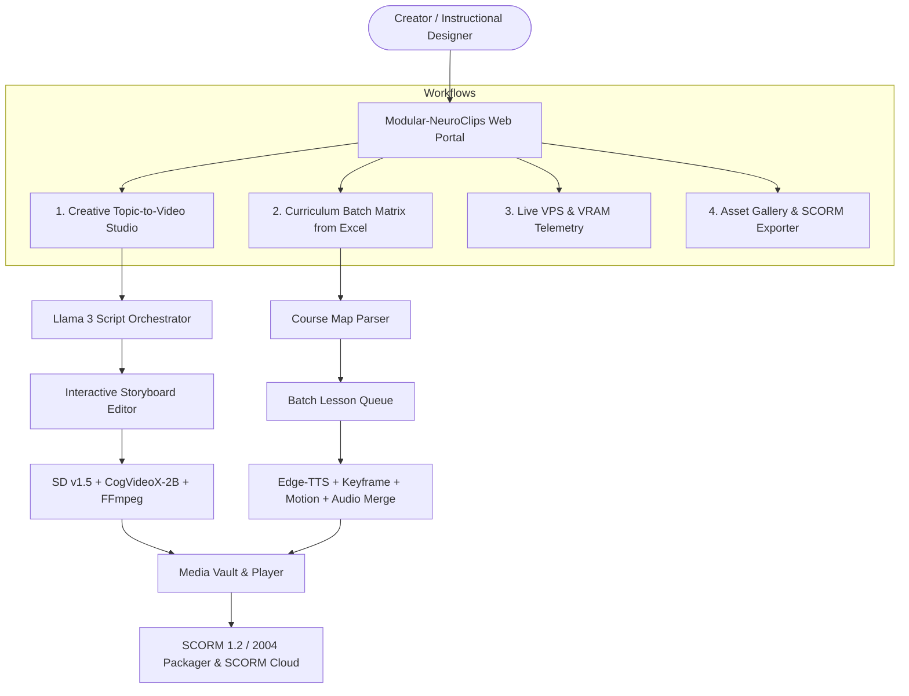
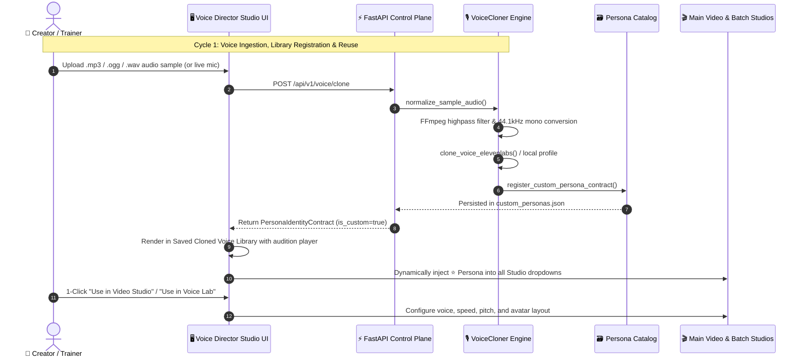

# Modular-NeuroClips UI Portal — Product Requirements Document (PRD) & Technical Specification

**Document Version:** 1.0.0  
**Target Platform:** Modular-NeuroClips Web UI & API Control Plane  
**Target Audience:** Product Engineers, Frontend Developers, Backend ML Engineers, UX/UI Designers  
**Status:** Ready for Implementation  

---

## 1. Executive Summary & Vision

### 1.1 Product Vision
**Modular-NeuroClips** is a next-generation local and VPS-hosted AI video generation workbench and automated curriculum authoring platform. It bridges the gap between deep learning generative models (Llama 3, Stable Diffusion v1.5, CogVideoX-2B-I2V, Edge-TTS, FFmpeg) and non-technical instructional designers or creative directors.

The **Modular-NeuroClips UI Portal** transforms the CLI and raw FastAPI scripts into a modern, responsive, and real-time creator control room. Users can create single-prompt cinematic video clips with interactive scene storyboards, batch-synthesize multi-hour educational courses directly from Excel curriculum sheets, monitor GPU VRAM telemetry with active memory guards, and export production-ready SCORM 1.2 / 2004 e-learning packages for LMS deployment.

### 1.2 Technology & Model Architecture Stack

| Subsystem | Underlying Technology / Model | Role in Studio Portal |
| :--- | :--- | :--- |
| **Orchestration LLM** | Ollama / Llama 3 (8B) | Directorial script generation, scene visual/motion prompt engineering, narration structuring |
| **Image Synthesis (T2I)** | RunwayML / Stable Diffusion v1.5 | Ultra-fast SD keyframe rasterization (576x320 / 512x512) |
| **Image-to-Video (I2V)**| THUDM / CogVideoX-2B-I2V | Neural motion animation from keyframes with sequential CPU offload |
| **Voice Synthesis (TTS)**| Microsoft Edge-TTS (NeerjaNeural / GuyNeural / etc.) | Zero-VRAM neural voiceover narration with subtitle timestamping |
| **Video Engine** | FFmpeg (libx264, aac, yuv420p) | Timeline stitching, looping, aspect scaling, audio-video sync |
| **Backend Framework** | FastAPI + Uvicorn + Pydantic v2 + PyNVML | Asynchronous task scheduling, SSE/WebSocket telemetry, REST APIs |
| **Frontend Stack** | Modern React (Vite / Next.js) + Tailwind CSS + Lucide Icons + TanStack Query + Zustand | Reactive single-page control plane, drag-and-drop storyboards, video players |
| **Packaging & LMS** | PowerShell / Python Zip + SCORM Cloud API v2 | SCORM 1.2/2004 manifest generation, ZIP packaging, cloud LMS distribution |

---

## 2. User Personas & Core Workflows



### 2.1 Primary User Personas
1. **The Instructional Designer (EdTech / Enterprise L&D):**
   - *Needs:* Upload spreadsheet courses (e.g. `Nipuna_AI_Agents_in_FinTech_15_Hour_Course-updated-v3.xlsx`), auto-generate narrator voiceovers and contextual animations, and download standardized SCORM packages for Moodle/Canvas/SCORM Cloud.
2. **The AI Creative Director & Video Marketer:**
   - *Needs:* Input high-level video concepts, preview structured directorial scripts, tweak visual/motion prompts per scene, regenerate single keyframes without re-rendering the whole video, and compile final SD/HD video clips.
3. **The VPS / Infrastructure Operator:**
   - *Needs:* Monitor GPU utilization and VRAM saturation in real-time, view pipeline state transitions, avoid CUDA out-of-memory (OOM) failures via memory guards, and cancel/retry stuck jobs.

---

## 3. Functional Requirements & Feature Modules

### Module 1: Prompt/Topic-to-Video Studio
- **Input Controls:** Topic input text area, target scene count selector (1–10 scenes), art style preset selector (e.g., *Cinematic 35mm, Cyberpunk Neon, Minimalist Flat 2D, Photorealistic Corporate, Watercolor Anime*), and aspect ratio selector (16:9 576x320, 1:1 512x512, 9:16 vertical).
- **Two-Stage Generation Workflow:**
  1. *Stage 1 (Scripting):* Prompts Llama 3 via Ollama to produce a structured JSON screenplay containing title, art style preset, visual prompts, motion prompts, and target durations.
  2. *Stage 2 (Production):* User reviews the script, modifies prompts if desired, and triggers generation.

### Module 2: Interactive Storyboard & Scene Breakdown Editor
- **Scene Cards Grid / List:** Visual cards for each scene displaying:
  - Scene ID & Index
  - Visual Prompt (Text-to-Image) with inline edit & auto-enhance button
  - Motion Prompt (Image-to-Video camera movement)
  - Keyframe Image Thumbnail (with single-click "Regenerate Keyframe" and "Upload Custom Image")
  - Video Clip Preview (with "Render Clip" button)
  - Voiceover Narration text & Audio preview player
- **Interactive Controls:**
  - Add Scene / Delete Scene / Reorder Scenes (drag-and-drop).
  - Bulk Actions: "Render All Scenes", "Compile Selected into Final Video".

### Module 3: Real-Time Hardware Telemetry & VPS Monitor
- **Live VRAM Gauge:** Dynamic radial or progress gauge showing VRAM MB used vs total MB and percentage.
- **GPU Utilization Tracker:** Real-time percentage meter and sparkline chart.
- **Pipeline Activity Status:** Active step display (e.g., `Idle`, `Prompting Llama 3`, `Rendering Scene 2/4 Keyframe`, `CogVideoX Motion Generation`, `FFmpeg Concatenation`, `Complete`).
- **Memory Guard Actions:** Manual "Purge VRAM / Empty Cache" button executing `gc.collect()`, `torch.cuda.empty_cache()`, and `torch.cuda.ipc_collect()`.
- **Live Event Log Stream:** Terminal-like console panel streaming backend logs and latency timings.

### Module 4: Curriculum Batch Matrix (Excel & Course Map Importer)
- **File Uploader:** Drag-and-drop upload for `.xlsx` and `.csv` files (e.g., FinTech 15-Hour Course map).
- **Sheet & Column Mapping Modal:** Auto-detect sheets (e.g., `Course Map`) and allow users to map columns for `Lesson ID`, `Narration Script`, `Visual Prompt`, `Module Name`, and `Duration`.
- **Course Matrix Data Grid:**
  - Tabular view of all lessons with columns: Lesson ID, Title/Topic, Voiceover Status, Keyframe Status, Clip Status, Final Video Status, Duration, Actions.
  - Granular execution: "Process All", "Process Module", or "Synthesize Single Lesson".
  - Voice Profile Selector: Multi-voice dropdown (e.g., `en-IN-NeerjaNeural`, `en-US-GuyNeural`, `en-US-JennyNeural`, `en-GB-SoniaNeural`).

### Module 5: Media Vault, Player & Timeline Inspector
- **Unified Media Browser:** Filter by Project, Curriculum Track, or Standalone Clip.
- **Enhanced Video Player:**
  - Custom controls: Play/pause, playback speed (0.5x–2x), timeline scrubbing, loop toggle, picture-in-picture, fullscreen.
  - Split View: Compare initial Keyframe PNG vs rendered MP4 animation side-by-side.
  - Waveform visualizer for synced Edge-TTS narration.
- **Export & Download:** Quick download for MP4, PNG keyframe bundle, MP3 voiceover, or JSON metadata.

### Module 6: LMS & SCORM 1.2 / 2004 Exporter
- **Automated Manifest Builder:** Generates SCORM-compliant `imsmanifest.xml` and HTML5 player wrapper (`index.html`) linking the synthesized video, narration, and lesson metadata.
- **ZIP Packaging:** Compresses course assets into a deployable `.zip` archive.
- **Direct SCORM Cloud API Integration:** (Matches `SCORM.json` n8n workflow architecture):
  - Configure SCORM Cloud App ID & Secret Key in Settings.
  - One-click "Deploy to SCORM Cloud" with upload job status tracking.

### Module 7: Async Job Queue & Worker History
- **Task Queue Dashboard:** Priority queue list showing Pending, In-Progress, Completed, and Failed jobs.
- **Execution History:** Historical record of all generated scripts, keyframes, renders, total render durations, and model latencies.
- **Abort / Retry Capability:** Cancel active long-running diffusion inferences safely.

---

## 4. UI / UX Design Specifications & Wireframes

### 4.1 Design System & Theme Tokens
- **Theme:** Dark Cyberpunk / Modern Enterprise Studio Glassmorphism.
- **Color Palette:**
  - Background Base: `#0B0F19` (Deep Obsidian)
  - Card / Panel Surface: `#1E293B` / `#0F172A` with `rgba(255, 255, 255, 0.05)` border stroke
  - Primary Accent: `#38BDF8` (Sky Blue / AI Pulse)
  - Secondary Accent: `#818CF8` (Indigo Director)
  - Success Indicator: `#10B981` (Emerald Green)
  - Warning / VRAM Alert: `#F59E0B` (Amber)
  - Error / OOM Danger: `#F43F5E` (Rose)
  - Text Primary: `#F8FAFC`, Secondary: `#94A3B8`, Muted: `#64748B`
- **Typography:**
  - Headings & UI: `Inter`, `system-ui`, sans-serif
  - Prompts, Code & Telemetry: `JetBrains Mono`, `Fira Code`, monospace

### 4.2 Application Layout Architecture

```
+---------------------------------------------------------------------------------------------------+
|  [Logo] Modular-NeuroClips Studio   |   [Status: Idle]  |  [VRAM: 4.2 / 12.0 GB (35%)]  |  [⚙ Settings] |
+---------------------------------------------------------------------------------------------------+
| SIDEBAR         | MAIN CONTENT WORKSPACE                                                         |
|                 |                                                                                |
| 🎬 Studio Gen   | [ Topic-to-Video Prompt Studio ]                                               |
| 📋 Storyboard   |  Topic: [ Explaining Decentralized Finance and Liquidity Pools ________ ]    |
| 📚 Curriculum   |  Scenes: [ 3 ]   Style: [ Cinematic 35mm ▼ ]   Voice: [ NeerjaNeural ▼ ]       |
| 🎞️ Media Vault  |  [ ✨ Generate Screenplay ]  [ 🚀 Fast Direct Render ]                          |
| 📦 SCORM Hub    |--------------------------------------------------------------------------------|
| ⚡ Telemetry     | [ Storyboard & Scene Breakdown ]                                               |
|                 |  +------------------+  +------------------+  +------------------+             |
|                 |  | Scene 1 (0:04)   |  | Scene 2 (0:04)   |  | Scene 3 (0:04)   |  [+ Add]    |
|                 |  | [Keyframe Image] |  | [Keyframe Image] |  | [Keyframe Image] |             |
|                 |  | Visual Prompt... |  | Visual Prompt... |  | Visual Prompt... |             |
|                 |  | Motion Prompt... |  | Motion Prompt... |  | Motion Prompt... |             |
|                 |  | [🎬 Render Clip] |  | [🎬 Render Clip] |  | [🎬 Render Clip] |             |
|                 |  +------------------+  +------------------+  +------------------+             |
|                 |--------------------------------------------------------------------------------|
|                 | [ Live Production Console / Video Preview ]                                    |
|                 |  [ ▶ Video Player: final_production_sd.mp4 ] | Logs: [12:04] Keyframe rendered |
+---------------------------------------------------------------------------------------------------+
| FOOTER: GPU 0: NVIDIA RTX 3060 (12GB) | PyTorch 2.4.0 CUDA | Active Job: None | VRAM Guard: Active|
+---------------------------------------------------------------------------------------------------+
```

---

## 5. API Contracts & Technical Specifications

### 5.1 REST API Endpoints

#### 5.1.1 Orchestrator & Scripting APIs

##### `POST /api/v1/orchestrator/script`
Generate a structured multi-scene video screenplay from a high-level concept topic.
- **Request Body:**
```json
{
  "topic": "Decentralized Autonomous Organizations in Fintech",
  "scene_count": 3,
  "art_style_preset": "Cinematic 35mm, volumetric lighting, photorealistic 8k",
  "model": "llama3"
}
```
- **Response Body (200 OK):**
```json
{
  "status": "success",
  "script": {
    "title": "Decentralized Autonomous Organizations Explained",
    "art_style_preset": "Cinematic 35mm, volumetric lighting, photorealistic 8k",
    "scenes": [
      {
        "scene_id": 1,
        "visual_prompt": "Futuristic glass boardroom with glowing holographic voting nodes floating in center, digital tokens interacting in golden light",
        "motion_prompt": "Slow clockwise camera rotation tracking glowing nodes with subtle depth-of-field shift",
        "narration": "Decentralized Autonomous Organizations reinvent corporate governance through code.",
        "duration_seconds": 4
      },
      {
        "scene_id": 2,
        "visual_prompt": "Smart contract code glowing in translucent blue streams connecting global avatars across a digital earth map",
        "motion_prompt": "Smooth forward dolly zoom following stream of transactions into a central node",
        "narration": "Smart contracts execute rules transparently without intermediaries.",
        "duration_seconds": 4
      },
      {
        "scene_id": 3,
        "visual_prompt": "A modern fintech smartphone interface showing instantaneous treasury distribution with upward analytics graphs",
        "motion_prompt": "Subtle handheld tilt up towards bright futuristic skyline",
        "narration": "Empowering distributed teams to manage millions in shared treasuries safely.",
        "duration_seconds": 4
      }
    ]
  },
  "generation_latency_seconds": 2.41
}
```

##### `POST /api/v1/orchestrator/refine-scene`
Refine or regenerate prompts for a single scene.
- **Request Body:**
```json
{
  "scene_id": 2,
  "current_visual_prompt": "Smart contract code glowing...",
  "instruction": "Make the lighting warmer and add subtle robotic elements"
}
```
- **Response Body (200 OK):**
```json
{
  "status": "success",
  "scene": {
    "scene_id": 2,
    "visual_prompt": "Warm golden smart contract code glowing around sleek cybernetic hands operating a holographic ledger",
    "motion_prompt": "Gentle zoom-in on cybernetic fingers interacting with radiant data cubes"
  }
}
```

---

#### 5.1.2 Media Generation & Assembly APIs

##### `POST /api/v1/generate/keyframe`
Generate a single keyframe image using Stable Diffusion v1.5.
- **Request Body:**
```json
{
  "scene_id": 1,
  "prompt": "Cinematic 35mm, volumetric lighting, Futuristic glass boardroom...",
  "width": 576,
  "height": 320,
  "steps": 20,
  "guidance_scale": 6.5,
  "force_regenerate": false
}
```
- **Response Body (200 OK):**
```json
{
  "status": "success",
  "scene_id": 1,
  "image_path": "/render_output/scene_1_keyframe.png",
  "image_url": "/api/v1/assets/scene_1_keyframe.png",
  "render_time_seconds": 1.84
}
```

##### `POST /api/v1/generate/clip`
Synthesize an animated video clip from an initial keyframe image with CogVideoX-2B.
- **Request Body:**
```json
{
  "scene_id": 1,
  "image_path": "render_output/scene_1_keyframe.png",
  "motion_prompt": "Slow clockwise camera rotation tracking glowing nodes",
  "fps": 8,
  "num_inference_steps": 20
}
```
- **Response Body (200 OK):**
```json
{
  "status": "success",
  "scene_id": 1,
  "clip_path": "/render_output/scene_1_clip.mp4",
  "clip_url": "/api/v1/assets/scene_1_clip.mp4",
  "render_time_seconds": 18.32
}
```

##### `POST /api/v1/generate/audio`
Synthesize voiceover narration using Edge-TTS (0 VRAM).
- **Request Body:**
```json
{
  "scene_id": 1,
  "text": "Decentralized Autonomous Organizations reinvent corporate governance through code.",
  "voice": "en-IN-NeerjaNeural",
  "output_path": "render_output/scene_1_audio.mp3"
}
```
- **Response Body (200 OK):**
```json
{
  "status": "success",
  "scene_id": 1,
  "audio_url": "/api/v1/assets/scene_1_audio.mp3",
  "duration_seconds": 3.8
}
```

##### `POST /api/v1/generate/compile`
Concatenate scenes and synchronize audio tracks into the final production MP4.
- **Request Body:**
```json
{
  "project_name": "dao_explainer",
  "scenes": [
    { "clip_path": "render_output/scene_1_clip.mp4", "audio_path": "render_output/scene_1_audio.mp3" },
    { "clip_path": "render_output/scene_2_clip.mp4", "audio_path": "render_output/scene_2_audio.mp3" },
    { "clip_path": "render_output/scene_3_clip.mp4", "audio_path": "render_output/scene_3_audio.mp3" }
  ],
  "resolution": { "width": 576, "height": 320 },
  "fps": 24,
  "crf": 22
}
```
- **Response Body (200 OK):**
```json
{
  "status": "success",
  "output_filename": "final_production_dao_explainer.mp4",
  "video_url": "/api/v1/assets/final_production_dao_explainer.mp4",
  "total_duration_seconds": 12.0
}
```

---

#### 5.1.3 Curriculum Batch Matrix APIs

##### `POST /api/v1/curriculum/upload`
Upload an Excel course map workbook (`.xlsx`, `.csv`).
- **Form Data:** `file: <binary>`
- **Response Body (200 OK):**
```json
{
  "status": "success",
  "file_id": "curriculum_fintech_v3",
  "sheets": ["Course Map", "Meta Info", "Assessments"],
  "detected_columns": {
    "Course Map": ["Lesson_ID", "Module_Name", "Topic", "Visual_Prompt", "Narration_Script", "Duration_Min"]
  },
  "row_count": 48
}
```

##### `POST /api/v1/curriculum/batch-run`
Trigger automated generation for mapped lessons in background queue.
- **Request Body:**
```json
{
  "file_id": "curriculum_fintech_v3",
  "sheet_name": "Course Map",
  "voice_profile": "en-IN-NeerjaNeural",
  "column_mappings": {
    "lesson_id": "Lesson_ID",
    "visual_prompt": "Visual_Prompt",
    "narration_script": "Narration_Script"
  },
  "selected_lesson_ids": ["L1.1", "L1.2", "L1.3"]
}
```
- **Response Body (202 Accepted):**
```json
{
  "job_id": "job_batch_curriculum_9918",
  "status": "queued",
  "total_lessons": 3,
  "estimated_time_minutes": 6.5
}
```

---

#### 5.1.4 SCORM 1.2 / 2004 Packaging & LMS Deployment APIs

##### `POST /api/v1/scorm/package`
Generate standard SCORM 1.2 / 2004 manifest and bundle into a deployable `.zip`.
- **Request Body:**
```json
{
  "course_id": "NovaAI_Module_2",
  "course_title": "AI Agents in FinTech - Module 2",
  "scorm_version": "1.2",
  "lesson_files": [
    { "lesson_id": "L2.1", "video_path": "curriculum_output/L2.1/final_lesson.mp4", "title": "Algorithmic Risk Agents" },
    { "lesson_id": "L2.2", "video_path": "curriculum_output/L2.2/final_lesson.mp4", "title": "Automated Settlement" }
  ]
}
```
- **Response Body (200 OK):**
```json
{
  "status": "success",
  "package_path": "curriculum_output/scorm_packages/NovaAI_Module_2_scorm12.zip",
  "download_url": "/api/v1/scorm/download/NovaAI_Module_2_scorm12.zip",
  "file_size_mb": 42.6
}
```

##### `POST /api/v1/scorm/deploy-cloud`
Deploy package directly to SCORM Cloud API v2 (matching `SCORM.json` workflow).
- **Request Body:**
```json
{
  "course_id": "NovaAI_Module_2",
  "zip_path": "curriculum_output/scorm_packages/NovaAI_Module_2_scorm12.zip",
  "scorm_app_id": "ENV_OR_CUSTOM_KEY",
  "scorm_secret_key": "ENV_OR_CUSTOM_SECRET"
}
```
- **Response Body (200 OK):**
```json
{
  "status": "success",
  "import_job_id": "scorm_import_78419",
  "cloud_course_id": "NovaAI_Module_2",
  "check_status_url": "https://cloud.scorm.com/api/v2/courses/importJobs/scorm_import_78419"
}
```

---

#### 5.1.5 Real-Time Telemetry Streaming (SSE & WebSocket)

##### `GET /api/v1/telemetry/stream` (SSE Stream)
- Emits real-time state every 1.0 second:
```json
data: {
  "gpu": {
    "used_mb": 4120.5,
    "total_mb": 12288.0,
    "utilization": 78
  },
  "state": {
    "status": "Rendering Scene 2/3",
    "current_step": "Video Animation with CogVideoX",
    "last_error": null,
    "model_load_latency": 1.45,
    "processed_scenes": 2,
    "total_scenes": 3,
    "active_job_id": "job_studio_4102"
  },
  "system": {
    "cpu_percent": 24.5,
    "ram_used_gb": 8.1,
    "ram_total_gb": 32.0
  },
  "timestamp": 1724949200.12
}
```

##### `POST /api/v1/telemetry/purge-vram`
Manually trigger `VRAMGuard.cleanup()`.
- **Response Body (200 OK):**
```json
{
  "status": "success",
  "freed_mb": 3420.0,
  "current_used_mb": 650.2
}
```

---

## 6. Directory & File Storage Layout

```
Modular-NeuroClips/
├── .env                                  # Configuration & API secrets
├── main.py                               # CLI entrypoint
├── app.py                                # FastAPI web server entrypoint
├── requirements.txt                      # Python dependencies
├── SCORM.json                            # n8n SCORM pipeline reference
├── src/
│   ├── config.py                         # Environment variables & constants
│   ├── orchestrator.py                   # Llama 3 LangChain director
│   ├── pipeline.py                       # SD v1.5 + CogVideoX engines + VRAMGuard
│   ├── compiler.py                       # FFmpeg concatenation & transcoding
│   ├── curriculum_engine.py              # Excel course processor & Edge-TTS
│   ├── dashboard.py                      # Telemetry & legacy HTML control plane
│   ├── job_manager.py                    # [NEW] Async job queue & state manager
│   ├── scorm_builder.py                  # [NEW] XML manifest & SCORM packager
│   └── routes/                           # [NEW] Modular FastAPI API routers
│       ├── __init__.py
│       ├── studio.py
│       ├── curriculum.py
│       ├── scorm.py
│       ├── gallery.py
│       └── telemetry.py
├── frontend/                             # [NEW] Modern React UI portal
│   ├── index.html
│   ├── package.json
│   ├── vite.config.ts
│   ├── tailwind.config.js
│   └── src/
│       ├── components/
│       │   ├── Studio/                   # Topic generator & storyboard cards
│       │   ├── Storyboard/               # Scene drag-and-drop & prompt editor
│       │   ├── Curriculum/               # Excel course matrix & batch queue
│       │   ├── Player/                   # Custom video player & track sync
│       │   ├── SCORM/                    # SCORM packaging & deployment modal
│       │   ├── Telemetry/                # Live VRAM radial meter & log stream
│       │   └── Layout/                   # Sidebar, Navbar, Footer
│       ├── hooks/                        # useTelemetrySSE, useJobQueue, useMedia
│       ├── store/                        # Zustand app & playback state
│       └── App.tsx
├── render_output/                        # Generated PNGs, MP4 clips, Final videos
└── curriculum_output/                    # Lesson folders, MP3s, SCORM ZIP packages
```

---

## 7. Business & Functional Requirements: Custom Voice Cloning & Universal Document Speech Engine

### 7.1 Business Requirements Document (BRD)

| Requirement ID | Strategic Intent | Business Metric / Outcome | Target User | Priority |
| :--- | :--- | :--- | :--- | :---: |
| **BRD-VOICE-01** | **User Voice Cloning & Asset Ownership** | Enables trainers, SME executives, and professors to clone their real voice from a 15-30s audio recording (.mp3, .ogg, .wav) and save it as an immutable persona asset. Eliminates generic, synthetic-sounding narrators. | Enterprise L&D, Solo Founders, Corporate Trainers | P0 |
| **BRD-VOICE-02** | **Zero Marginal Cost Local Cloning Option** | Provide a hybrid approach: Premium cloud voice cloning (ElevenLabs Instant Voice Clone) alongside local reference-based zero-cost cloning (Kokoro / XTTS), preventing API cost blowouts. | Budget-conscious course creators, Higher Ed | P0 |
| **BRD-VOICE-03** | **Persistent Voice Library & Cross-Studio Reuse** | Provide a centralized, cataloged Cloned Voice Library enabling immediate in-browser auditioning, sample management, deletion, and 1-click cross-studio reuse across Voice Director, Main Video Studio, Batch Slide Generation, and Curriculum Batch Pipelines. | Instructional Ops, Course Directors, Solo Founders | P0 |
| **BRD-DOC-01** | **Universal Document-to-Audio Ingestion** | Ingest raw educational materials (`.txt`, `.md`, `.docx`, `.pdf`) and automatically decompose them into pedagogical narration scenes aligned to any selected voice (cloned or pre-baked). | Curriculum Designers, Content Teams | P0 |
| **BRD-DOC-02** | **SCORM 1.2 / 2004 Audio Package Assembly** | Turn any uploaded book chapter or lecture document into a fully packaged, interactive SCORM module with synchronized subtitles and knowledge checks in under 60 seconds. | Enterprise LMS Administrators | P1 |
| **BRD-BATCH-01** | **Automated Curriculum Batch Video & Audio Pipeline** | Ingest full multi-module curriculum definitions and automatically synthesize neural speech, timing manifests, synchronous subtitles (.srt), and high-resolution Remotion/FFmpeg composite videos across all lessons unattended. | Course Directors, Instructional Ops | P0 |
| **BRD-CLOUD-01** | **Direct Cloud LMS Ingestion (SCORM Cloud API v2)** | Programmatically upload and register generated SCORM packages into Rustici SCORM Cloud, retrieve test preview launch links, and configure learner dispatch without manual browser exports. | Enterprise LMS Integrators, Corporate L&D | P0 |

---

### 7.2 Functional Requirements Document (FRD)

#### 7.2.1 Workflow Architecture Diagram

```mermaid
flowchart TD
    %% Workflow 1: Voice Cloning & Library
    subgraph WF1["Workflow 1: User Voice Ingestion, Library Registration & Cross-Studio Reuse"]
        A1[Creator Records Mic or Uploads Audio .mp3, .ogg, .wav, .m4a] --> A2[Audio Normalization Gate: 44.1kHz Mono WAV]
        A2 --> A3{Duration & SNR Check: 5s to 600s}
        A3 -->|Fail| A_Err[Reject with Duration/Noise Error]
        A3 -->|Pass| A4{Cloud Key Available?}
        A4 -->|Yes| A5[ElevenLabs Instant Voice Clone API /v1/voices/add]
        A4 -->|No| A6[Compute Local Reference Embeddings]
        A5 --> A7[Persist Metadata to custom_personas.json]
        A6 --> A7
        A7 --> A8[Inject into PERSONA_CATALOG]
        A8 --> A9[📚 Saved Cloned Voice Library Grid in Voice Director]
        A9 --> A10([🎙️ Use in Voice Lab / 🎬 Use in Video Studio / ⚡ Batch Pipelines])
    end

    %% Workflow 2: Document-to-Speech & SCORM
    subgraph WF2["Workflow 2: Universal Document Ingestion & SCORM Delivery"]
        B1[Upload Raw Document .txt, .md, .docx, .pdf] --> B2[DocumentParser: Strip Formatting & Metadata]
        B2 --> B3[Sentence-Boundary Chunking: 40-80 Words/Scene]
        B3 --> B4[LexiconEngine: FinTech Pronunciation Pass]
        B4 --> B5[SSML Compiler: Tag Conversion break, prosody, emphasis]
        B5 --> B6[Select Cloned Voice or Canonical Persona]
        B6 --> B7[VoiceDirectorAgent Synthesis Loop]
        B7 --> B8[EBU R128 Loudness Normalization: -14 LUFS]
        B8 --> B9[Generate Millisecond-Aligned .srt Subtitles]
        B9 --> B10{Export SCORM 1.2 Enabled?}
        B10 -->|Yes| B11[SCORMPackager: Build imsmanifest.xml & HTML5 Player]
        B10 -->|No| B12([🎵 Master MP3 & Subtitles Delivered])
        B11 --> B13([📦 Interactive SCORM 1.2 ZIP Archive])
    end
```



#### 7.2.2 End-to-End Sequence Diagram



#### 7.2.3 Module 1: User Voice Recording, Library & Cross-Studio Reuse (`VoiceCloner`)

- **FRD-VC-01 (Multi-Format Audio Ingestion)**:
  - System shall support in-browser microphone recording (`MediaRecorder` API) and audio file upload (`.mp3`, `.ogg`, `.wav`, `.m4a`).
  - System shall validate that audio length is between 5 seconds and 600 seconds and minimum size > 50KB.
  - System shall provide explicit UI file-selection indicators and live in-browser audition previews.
- **FRD-VC-02 (Storage & Normalization)**:
  - System shall save raw sample to `assets/voices/<clean_name>_<timestamp>.<ext>`.
  - System shall use FFmpeg to normalize the sample to 44.1kHz mono WAV with band-pass filtering (`highpass=f=80,lowpass=f=12000,aresample=44100`).
- **FRD-VC-03 (Provider Binding & Gender Classification)**:
  - System shall capture presenter gender (`female`, `male`, `non_binary`) and regional locale (`en-IN`, `te-IN`, `hi-IN`, `en-US`, `en-GB`).
  - **Cloud Path (ElevenLabs)**: System shall call `POST https://api.elevenlabs.io/v1/voices/add` passing `name`, `description`, and `files=[sample_path]`. Stores returned `voice_id`.
  - **Local Path (Reference Speaker Profiles)**: System shall compute voice speaker conditioning profile and save it in `assets/voices/`.
- **FRD-VC-04 (Dynamic Persona Catalog Registry & Lifecycle)**:
  - System shall persist the new voice into `src/contracts/custom_personas.json` and dynamically inject it into `PERSONA_CATALOG` (`PersonaIdentityContract`).
  - System shall provide a `DELETE /api/v1/voice/personas/{persona_id}` endpoint to safely prune custom personas while protecting canonical identities.
- **FRD-VC-05 (Saved Cloned Voice Library UI)**:
  - System shall render a dedicated **Saved Cloned Voice Library** grid in the Voice Director tab showing:
    - Display Name, Gender badge, Locale tag.
    - Inline audio audition player for reference samples.
    - Delete button with confirmation modal.
- **FRD-VC-06 (1-Click Cross-Studio Reuse)**:
  - `🎙️ Use in Voice Lab`: Automatically populates `#voice-lab-voice` and switches to the Voice Director tab.
  - `🎬 Use in Video Studio`: Automatically switches to Multi-Agent Video Studio, selecting the custom voice in `#voice-select` and assigning matching avatar persona in `#avatar-persona-select`.
  - System shall synchronize all custom cloned voices into `#batch-slide-persona` and `#curriculum-batch-persona` for batch automation.

#### 7.2.4 Module 2: Universal File-to-Speech Ingestion (`DocumentVoiceEngine`)

- **FRD-DFS-01 (Multi-Format Document Parsing)**:
  - System shall accept `.txt`, `.md`, `.docx`, and `.pdf` files up to 25MB via `POST /api/v1/voice/synthesize-file`.
  - System shall strip markup syntax, table artifacts, citations, and metadata headers to extract clean narrative prose.
- **FRD-DFS-02 (Pedagogical Scene Slicing)**:
  - System shall decompose long text into pedagogical scenes bounded by natural sentence breaks (target: 40–80 words / 20–40 seconds per scene).
  - Maximum scenes per document run: 50 scenes (auto-paginated for larger books/decks).
- **FRD-DFS-03 (Lexicon & SSML Infusion)**:
  - System shall route every scene through `LexiconEngine` (`src/lexicon.py`) to enforce correct pronunciation of enterprise acronyms (KYC, UPI, NBFC, SEBI, etc.).
  - System shall compile prosody tags (`[pause]`, `[emphasis]`, `[tone]`) into SSML tags.
- **FRD-DFS-04 (Universal Voice Synthesis & Packaging)**:
  - System shall pass the sliced scenes to `VoiceDirectorAgent` with the user-selected voice (default, custom cloned, or pre-baked catalog persona).
  - System shall generate:
    1. Per-scene audio files with exact `ffprobe` measured durations.
    2. Master concatenated audio track normalized to -14 LUFS.
    3. Synchronized `.srt` and `.vtt` subtitle files.
    4. Optional one-click ADL SCORM 1.2 zip archive for direct LMS distribution.

#### 7.2.5 Module 3: Automated Curriculum Batch Synthesis & Remotion Video Rendering (`CurriculumBatchRunner`)

- **FRD-BATCH-01 (Matrix Traversal & Batch Voice Synthesis)**:
  - System shall traverse all course modules (Modules 1 to 7) and generate structured audio slides named according to canonical schema: `M{m}_T{t}_L{l}_Slide{s}.mp3`.
  - System shall generate synchronized sentence-level `.srt` subtitles alongside each slide audio file.
  - System shall compile `batch_manifest.json` recording slide title, audio file relative path, exact duration in seconds, subtitle path, and frame count at 30fps.
- **FRD-BATCH-02 (Remotion React Engine & FFmpeg Video Compositing)**:
  - System shall feed `batch_manifest.json` into Remotion composition (`FintechAgentLesson`) or the FFmpeg hardware-accelerated video pipeline.
  - System shall render complete lesson videos (`FINTECH_AGENTS_*.mp4`) combining visual slides, audio narration, kinetic typography subtitles, and animated avatar overlays.

#### 7.2.6 Module 4: Rustici SCORM Cloud Direct Deployment (`SCORMCloudClient`)

- **FRD-CLOUD-01 (API v2 Basic Auth & Cloud Course Ingestion)**:
  - System shall connect to SCORM Cloud API v2 (`https://cloud.scorm.com/api/v2`) using HTTP Basic Authentication (`SCORM_CLOUD_APP_ID` / `SCORM_CLOUD_SECRET_KEY`).
  - System shall upload generated SCORM course packages directly using asynchronous import jobs (`POST /courses/uploadJobs`).
- **FRD-CLOUD-02 (Course Preview & Registration Dispatch)**:
  - System shall support generating preview launch links (`POST /courses/{course_id}/preview`) for instant verification in browser.
  - System shall support creating learner registrations and generating tracked launch links (`POST /registrations/{registration_id}/launchLink`).

```mermaid
flowchart TD
    %% Workflow 3: Batch Curriculum Pipeline
    subgraph WF3["Workflow 3: Automated Batch Video Synthesis (CurriculumBatchRunner)"]
        C1[Curriculum Course Definition] --> C2[Matrix Traversal: Modules 1..7]
        C2 --> C3[VoiceDirector: Edge-TTS Neural Speech]
        C3 --> C4[Per-Slide M{m}_T{t}_L{l}_Slide{s}.mp3 + .srt]
        C4 --> C5[Compile batch_manifest.json with Millisecond Timing]
        C5 --> C6[Remotion React Bundle / FFmpeg Compositor]
        C6 --> C7([🎬 Production Lesson Video: FINTECH_AGENTS_*.mp4])
    end

    %% Workflow 4: SCORM Cloud Direct Deploy
    subgraph WF4["Workflow 4: SCORM Cloud API v2 Direct Deployment"]
        D1[SCORM 1.2 / 2004 ZIP Package] --> D2[SCORMCloudClient API v2 Ingestion]
        D2 --> D3{POST /courses/uploadJobs}
        D3 --> D4[Poll Job Status until Complete]
        D4 --> D5[POST /courses/{course_id}/preview]
        D5 --> D6([🚀 Instant Cloud LMS Launch Link])
    end
```

---

## 8. Implementation Roadmap & Milestones

### Phase 1: Backend Refactoring & API Expansion (Senior Backend Dev)
1. **Modularize API Routers:** Split `app.py` and `dashboard.py` into clean FastAPI APIRouters under `src/routes/`.
2. **Job Queue & State Management:** Implement `src/job_manager.py` with multi-scene cancellation, task progress tracking, and persistent job history.
3. **SCORM Packager Extension:** Implement `src/scorm_builder.py` to programmatically build `imsmanifest.xml`, generate HTML5 course wrappers, zip archives, and SCORM Cloud API integration.
4. **Enhanced Telemetry:** Extend NVML stats with CPU/RAM metrics and SSE broadcast channels.

### Phase 2: Custom Voice Cloning & Universal Document Speech Engine
1. **Voice Registration Engine:** Implement `src/agents/voice_cloner.py` with ElevenLabs voice cloning API and local speaker embedding ingestion.
2. **Document Parser & Scene Slicer:** Implement `src/document_parser.py` supporting `.txt`, `.md`, `.docx`, and `.pdf`.
3. **Dynamic Persona Registry:** Implement persistent JSON catalog loader in `src/contracts/persona.py`.
4. **Voice Lab UI Widgets:** Add microphone audio recorder and document drag-and-drop zone to the dashboard.

### Phase 3: Modern Frontend Portal Scaffolding (Senior Frontend Dev)
1. **React / Vite Setup:** Initialize modern TypeScript + Vite + Tailwind CSS portal with Lucide icons.
2. **Telemetry Dock & Real-Time SSE:** Connect to `/api/v1/telemetry/stream` with live VRAM progress rings and pulse animations.
3. **Studio & Storyboard Components:** Build Prompt Generator, Art Style Selector, and Drag-and-Drop Scene Cards.
4. **Curriculum Batch Importer:** Implement spreadsheet upload, column mapping dialog, and live lesson progress data grid.
5. **SCORM Exporter & Media Vault:** Build video playback inspector and one-click SCORM ZIP downloader.

---

*PRD and Specifications signed off for immediate development.*
