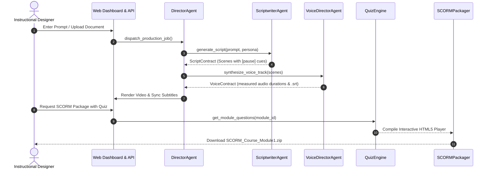

# ⚡ Modular-NeuroClips Studio (v2.6)
> **Autonomous Multi-Agent AI Video, Audio Master, & LMS Courseware Production Engine**  
> *Industrial-scale generative manufacturing platform transforming curriculum spreadsheets and raw prompts into broadcast-grade video lectures, neural audio masters, and interactive SCORM 1.2 / 2004 e-learning packages.*

---

## 📑 Table of Contents
1. [Executive Summary & Multi-Agent Architecture](#1-executive-summary--multi-agent-architecture)
2. [Multi-Agent Topology & Validation Gates](#2-multi-agent-topology--validation-gates)
3. [Persona & Demographic Consistency Matrix](#3-persona--demographic-consistency-matrix)
4. [Interactive Knowledge Check & Assessment Engine](#4-interactive-knowledge-check--assessment-engine)
5. [Dedicated Studio Workbenches](#5-dedicated-studio-workbenches)
   - [🎬 Multi-Agent Video Studio](#-multi-agent-video-studio)
   - [🎙️ Voice Director Studio & Audio Master Exporter](#-voice-director-studio--audio-master-exporter)
   - [📦 Custom SCORM & LMS Courseware Generator](#-custom-scorm--lms-courseware-generator)
6. [High-Level Design (HLD) & Sequence Diagrams](#6-high-level-design-hld--sequence-diagrams)
7. [API Specifications & REST Endpoints](#7-api-specifications--rest-endpoints)
8. [Deployment & VPS Control Plane](#8-deployment--vps-control-plane)

---

## 1. Executive Summary & Multi-Agent Architecture

**Modular-NeuroClips Studio** is an autonomous generative production engine engineered for corporate L&D academies, universities, and enterprise instructional designers.

```
Modular-NeuroClips/
├── MULTI_AGENT_ORCHESTRATION_SPEC.md   # Complete architectural specification & sequence diagrams
├── src/
│   ├── contracts/
│   │   ├── persona.py                  # PersonaIdentityContract & certified demographic catalog
│   │   ├── script_contract.py          # ScriptContract & ScriptScene schemas
│   │   ├── voice_contract.py           # VoiceContract & SceneAudioArtifact (measured duration)
│   │   └── visual_contract.py          # ImageContract & SceneVisualArtifact schemas
│   ├── agents/
│   │   ├── director.py                 # 👑 DirectorAgent (Master Orchestrator & Gates)
│   │   ├── scriptwriter.py             # ✍️ ScriptwriterAgent (Pedagogical chunking & cues)
│   │   ├── voice_director.py           # 🎙️ VoiceDirectorAgent (Neural TTS & duration probe)
│   │   └── image_generator.py          # 🎨 ImageGeneratorAgent (Keyframes & avatar continuity)
│   ├── quiz_engine.py                  # 📝 Quiz & Assessment Engine (224 Nipuna items)
│   ├── nipuna_item_bank.json           # High-speed pre-indexed question bank
│   ├── scorm_packager.py               # 📦 SCORM 1.2 / 2004 Assembler with CMI tracking
│   ├── orchestrator.py                 # Multi-agent bridge facade
│   └── dashboard.py                    # FastAPI Web Portal & 3 Dedicated Studio Workbenches
```

---

## 2. Multi-Agent Topology & Validation Gates

The platform operates via a hierarchical multi-agent architecture where the **Director Agent** governs three specialized sub-agents through strict Pydantic input/output contracts.

```mermaid
flowchart TD
    UserQuery["Raw User Query / Topic / Document"] --> Director["👑 DirectorAgent (Master Orchestrator)"]
    
    subgraph Gate 1: Narrative & Pedagogical Structuring
        Director --> Scriptwriter["✍️ ScriptwriterAgent"]
        Scriptwriter -->|Decomposes into 1–16 scenes with [pause], [emphasis], [protip]| ScriptContract["ScriptContract"]
    end

    subgraph Gate 2: Audio-Visual Synchronization Lock
        ScriptContract --> VoiceDirector["🎙️ VoiceDirectorAgent"]
        VoiceDirector -->|Neural Edge-TTS / ElevenLabs + ffprobe measurement| VoiceArtifacts["VoiceContract (Exact Duration ms)"]
        VoiceArtifacts --> Director
    end

    subgraph Gate 3: Visual Continuity & Demographic Lock
        ScriptContract --> ImageGen["🎨 ImageGeneratorAgent"]
        ImageGen -->|Persona Anchors + 16:9 / 9:16 / 1:1 Layouts| ImageArtifacts["ImageContract"]
        ImageArtifacts --> Director
    end

    subgraph Final Compositing & Packaging
        Director --> Compositor["🎞️ FFmpeg & Remotion Compositor"]
        Compositor --> RenderOutput["Production Video (MP4)"]
        Compositor --> AudioMaster["Standalone Audio Masters (MP3/WAV/FLAC)"]
        Compositor --> SCORM["Interactive SCORM 1.2 Package with Quiz"]
    end
```

### Validation Gates Enforced by DirectorAgent:
* **Gate 1 (Script Validation)**: Rejects empty scenes, guarantees word bounds, ensures every scene has visual descriptions and narration before asset synthesis.
* **Gate 2 (AV Synchronization Lock)**: Probes exact millisecond audio lengths via `ffprobe` from `VoiceDirectorAgent` and dynamically locks video clip frame counts 1:1 to match, preventing visual freezes or truncated voiceovers.
* **Gate 3 (Persona Integrity)**: Enforces voice/avatar demographic compatibility and style token persistence.

---

## 3. Persona & Demographic Consistency Matrix

The `PersonaIdentityContract` (`src/contracts/persona.py`) couples visual demographic tokens, industry domains, and authentic regional voice models to prevent cognitive dissonance and persona drift.

| Persona ID | Display Name | Domain / Industry | Ethnicity / Demographic | Canonical Voice | Speech Rate | Layout Style |
| :--- | :--- | :--- | :--- | :--- | :---: | :--- |
| `maya_fintech` | Maya Sharma | FinTech & Algorithmic Trading | South Asian (Indian) | `en-IN-NeerjaNeural` | 1.00x | Modern Corner PiP |
| `alex_ai` | Alex Vance | AI & Cloud Architecture | Caucasian / North American | `en-US-GuyNeural` | 1.05x | Floating Glass Card |
| `elena_compliance` | Elena Rostova | Risk, Compliance & Legal | European / Global Corporate | `en-GB-SoniaNeural` | 0.95x | Left Third Bar |
| `david_trainer` | David Kim | Corporate L&D & Operations | East Asian / Tech Lead | `en-US-ChristopherNeural` | 1.00x | Bottom Floating Oval |
| `rajesh_cloud` | Rajesh Patel | DevOps & Distributed Systems | South Asian (Indian) | `en-IN-PrabhatNeural` | 1.00x | Top Right Minimalist |

---

## 4. Interactive Knowledge Check & Assessment Engine

The `QuizEngine` (`src/quiz_engine.py`) ingests **224 certified assessment items** across 7 modules from `Nipuna_AI_Agents_in_FinTech_15_Hour_Course-updated-v3.xlsx`:

* **Module 1**: Traditional AI vs GenAI vs Agents & Autonomy *(32 Questions)*
* **Module 2**: Agent Architecture, Planning & Tool Integration *(32 Questions)*
* **Module 3**: Retrieval-Augmented Generation & Financial Memory *(32 Questions)*
* **Module 4**: Multi-Agent Collaboration & Dispute Resolution *(32 Questions)*
* **Module 5**: Risk, Guardrails, Compliance & Governance *(32 Questions)*
* **Module 6**: Enterprise Deployment, Observability & Telemetry *(32 Questions)*
* **Module 7**: Algorithmic Execution, Settlement & Real-Time Trading *(32 Questions)*
* *Distribution per module:* 20 Knowledge Checks, 8 Scenario-Based items, 4 Applied checks.

### Interactive SCORM 1.2 / LMS Player
* **Dual-Tab Experience**: Learners seamlessly toggle between the **🎬 Video Lecture** and **📝 Knowledge Check & Quiz**.
* **Instant Rationale Feedback**: Submissions reveal immediate pedagogical rationales explaining why choices are correct or incorrect.
* **LMS CMI Tracking**: Automatically commits `cmi.core.score.raw` (0–100%) and `cmi.core.lesson_status` (`passed` for >= 70%, `incomplete` otherwise) via standard SCORM 1.2 JS API adapters.

---

## 5. Dedicated Studio Workbenches

The Web Portal features 3 dedicated studio workbenches accessible via the top mode switcher:

### 🎬 Multi-Agent Video Studio
* Full prompt-to-video pipeline with scene chunking slider (1–16 scenes), aspect ratio selector (16:9 HD, 9:16 Shorts, 1:1 Square), storyboard editor, video asset vault, and real-time GPU/CPU telemetry.

### 🎙️ Voice Director Studio & Audio Master Exporter
* Dedicated audio synthesis laboratory supporting:
  * **Custom Voice Recording & Cloning (`VoiceCloner`)**:
    * In-browser live microphone recording (`MediaRecorder` API) or audio file upload (`.wav`, `.ogg`, `.mp3`, `.m4a`).
    * FFmpeg conditioning to 44.1kHz mono WAV with high-pass noise filtering.
    * Cloud cloning via ElevenLabs Instant Voice Clone API (`/v1/voices/add`) with local reference speaker fallback.
    * Dynamic persona persistence into `src/contracts/custom_personas.json` and immediate registration in `PERSONA_CATALOG`.
  * **Universal Document-to-Speech Engine (`DocumentParser`)**:
    * Multi-format ingestion: `.txt`, `.md`, `.docx`, and `.pdf` files up to 25MB.
    * Automatic decomposition into bounded pedagogical scenes (40–80 words / 20–40s per scene).
    * Automated injection of domain pronunciation lexicons (`KYC`, `UPI`, `RBI`, `NBFC`, `SEBI`) and directorial prosody cues (`[pause]`, `[tone]`, `[emphasis]`).
  * **Broadcast Audio Mastering & SCORM Packaging**:
    * EBU R128 loudness normalization (-14 LUFS) and dynamic background music ducking.
    * Millisecond-accurate synchronized `.srt` subtitle generation.
    * One-click bundling into an ADL SCORM 1.2 course package.
  * **Two Input Modes**: Direct text / document upload OR **`✨ AI Expand Prompt`** mode with `ScriptwriterAgent`.
  * **Directorial Cues Toolbar**: 1-click injection of `[pause 250ms]`, `[pause 500ms]`, `[pause 1.0s]`, `[emphasis]`, `[protip]`.
  * **Prosody Tuning**: Speech Rate (`0.75x`–`1.50x`) and Pitch Shift (`-20Hz` to `+20Hz`).
  * **Multi-Format Audio Masters**: 1-click export in **MP3 (320kbps)**, **WAV (Lossless 44.1kHz)**, **M4A / AAC (Apple Podcasts)**, **OGG (Web Audio)**, and **FLAC (Audiophile)** with companion `.srt` subtitles.
  * **Live Audition Player**: Instant sample playback.

### 📦 Custom SCORM & LMS Courseware Generator
* Standalone e-learning packaging workbench supporting:
  * **Custom Course Metadata**: Course Title, Course Code/ID, Module Title, Lesson / Topic Name.
  * **Media Attachment**: Attach rendered videos from the Media Vault or run in video-free audio lecture mode.
  * **Item Bank Selector**: Choose which of the 7 Nipuna modules (32 questions each) to bundle.
  * **Passing Score Slider**: Configurable passing threshold (50% to 100%, default 70%).
  * **Dual SCORM Support**: Export to **SCORM 1.2** or **SCORM 2004 4th Edition**.
  * **CMI Data Model Inspector**: Real-time pre-flight verification of `imsmanifest.xml` and gradebook parameters.

---

## 6. High-Level Design (HLD) & Sequence Diagrams



---

## 7. API Specifications & REST Endpoints

### Multi-Agent & Script Endpoints
* `POST /api/v1/director/orchestrate`: Dispatches full Director-led multi-agent production job.
* `POST /api/v1/script/upload-document`: Cleans and ingests `.txt`, `.md`, `.srt`, `.vtt`, `.json` documents.
* `POST /api/v1/voice/expand-prompt`: Expands raw prompts into complete spoken scripts with directorial cues using `ScriptwriterAgent`.

### Voice Director & Document Speech Endpoints
* `POST /api/v1/voice/clone`: Uploads/records audio sample, normalizes via FFmpeg, clones voice (ElevenLabs or local reference), and registers a custom persona.
* `POST /api/v1/voice/synthesize-file`: Ingests `.txt`, `.md`, `.docx`, or `.pdf`, decomposes into scenes, applies pronunciation lexicon & SSML, and generates master audio, subtitles, and optional SCORM package.
* `GET /api/v1/voice/personas`: Returns all active canonical and user-cloned personas.
* `POST /api/v1/preview-voice`: Instant neural voice audition.
* `POST /api/v1/voice/export`: Synthesizes and converts master audio to **MP3, WAV, M4A, OGG, FLAC** with synchronous `.srt` subtitles.

### Quiz & SCORM Courseware Endpoints
* `GET /api/v1/quiz/modules`: Returns summary statistics for all 7 Nipuna course modules.
* `GET /api/v1/quiz/module/{module_id}`: Returns all 32 questions, options, correct keys, and rationales for a module.
* `POST /api/v1/scorm/export/{filename}?module_id=1`: 1-click SCORM exporter bundling rendered video with module quiz.
* `POST /api/v1/scorm/custom-build`: Compiles a custom SCORM 1.2 / 2004 package with custom metadata, media attachment, and module assessment.
* `GET /api/v1/scorm/packages`: Lists all available SCORM packages in the archive.

---

## 8. Deployment & VPS Control Plane

### Rootless Docker Deployment
```bash
# Clone repository
git clone https://github.com/DrisyonAI/Modular-NeuroClips.git
cd Modular-NeuroClips

# Switch to multi-agent branch
git checkout feature/multi-agent-orchestration

# Build & launch container
docker compose build
docker compose up -d
```

### Live Environment
* **Web Portal**: `https://neuroclips.mytestbed.tech/`
* **Local Control Plane**: `http://localhost:8130/`
* **Pull Request**: [PR #2 on GitHub](https://github.com/DrisyonAI/Modular-NeuroClips/pull/2)
