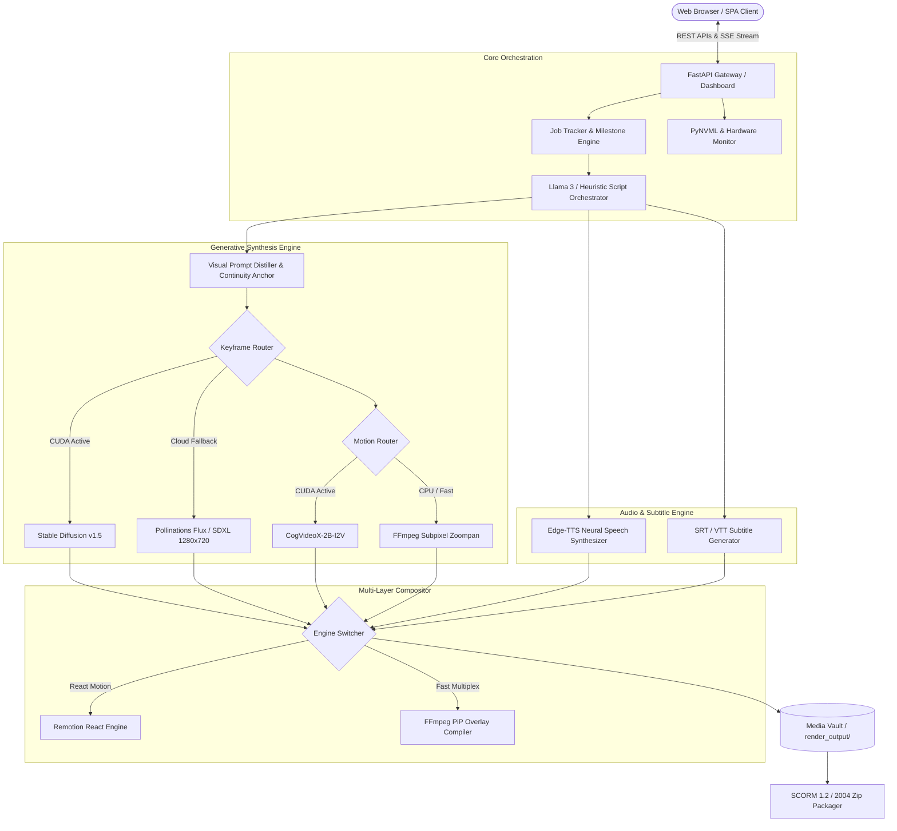
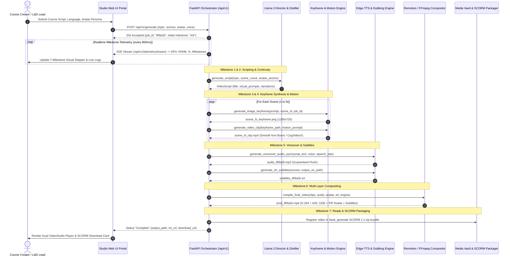
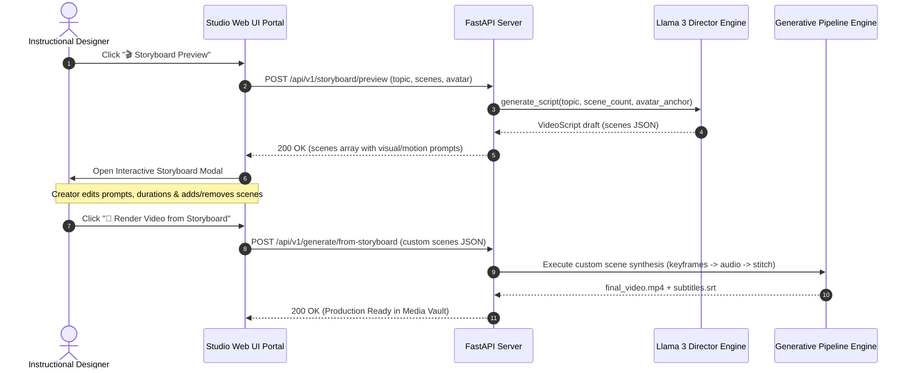
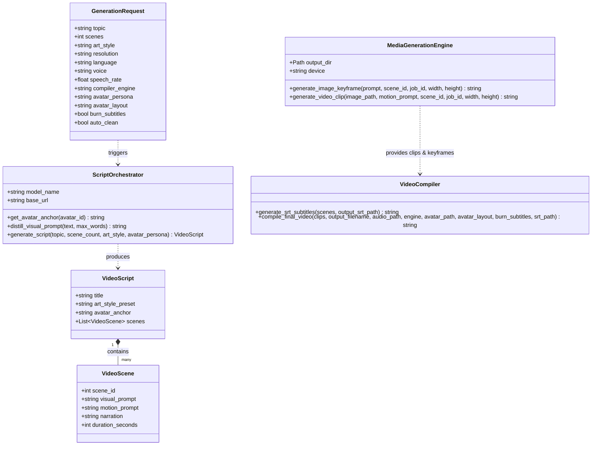

# ⚡ Modular-NeuroClips Studio (v2.6)
> **Autonomous AI Video, Courseware, & Multi-Modal LMS Producer**  
> *Transforming instructional text, spreadsheets, and concepts into broadcast-grade video courses with neural voiceovers, dynamic speaker avatars, and 1-click SCORM 1.2 packaging.*

---

## 📑 Table of Contents
1. [Executive Summary & Value Proposition](#1-executive-summary--value-proposition)
2. [Business Requirements Document (BRD)](#2-business-requirements-document-brd)
3. [Functional Requirements Document (FRD)](#3-functional-requirements-document-frd)
4. [High-Level Design (HLD) & Architecture](#4-high-level-design-hld--architecture)
5. [System Sequence & UML Diagrams](#5-system-sequence--uml-diagrams)
6. [Low-Level Design (LLD) & API Specifications](#6-low-level-design-lld--api-specifications)
7. [Multi-Language Dubbing & Regional Speech Suite](#7-multi-language-dubbing--regional-speech-suite)
8. [Remotion React & FFmpeg Multi-Layer Compositing](#8-remotion-react--ffmpeg-multi-layer-compositing)
9. [Deployment & Production Setup Guide](#9-deployment--production-setup-guide)

---

## 1. Executive Summary & Value Proposition

**Modular-NeuroClips** is an AI video generation workbench and automated curriculum authoring platform. It bridges the gap between deep learning generative models (Llama 3, Stable Diffusion v1.5, CogVideoX-2B-I2V, Edge-TTS, Remotion React, FFmpeg) and corporate Learning & Development (L&D) teams, instructional designers, and content creators.

### Core Value Drivers:
- ⏱️ **Cost & Time Compression**: Reduces traditional video course production costs from **$10,000+ / 4 weeks** down to **seconds per module** with zero cloud API credit drain.
- 🎭 **Character & Persona Continuity**: Maintains persistent presenter appearance, attire, and lighting across multi-scene screenplays.
- 🌐 **Global Accessibility**: Instant regional dubbing into **Telugu, Tamil, Hindi, Spanish, French, German, Japanese, and English** with localized `.srt` subtitles.
- 📦 **LMS Interoperability**: 1-click generation of standardized **SCORM 1.2 / 2004** packages ready for Moodle, Canvas, Blackboard, or SCORM Cloud.

---

## 2. Business Requirements Document (BRD)

### 2.1 Market Context & Industry Pain Points
Corporate training, compliance onboarding, and higher-education course development face three bottlenecks:
1. **High Production Overhead**: Filming studio sessions with live actors, audio technicians, and video editors is expensive and difficult to iterate when policies change.
2. **Inconsistent Quality & Visual Drift**: AI video tools often produce jarring character mutations between consecutive scenes.
3. **LMS Incompatibility**: Raw video files require manual packaging, XML manifest authoring, and subtitle synchronization for LMS deployment.

### 2.2 Target Personas
- **Enterprise L&D Directors**: Need automated multi-hour compliance and onboarding video production.
- **FinTech & Banking Educators**: Require visual accuracy for financial workflows, transaction diagrams, and regulatory topics.
- **Instructional Designers**: Require visual storyboard preview/editing before committing to full video rendering.

### 2.3 Success Metrics & ROI
- **Production Throughput**: >100 micro-lessons generated per VPS per day.
- **VRAM Resilience**: Zero CUDA Out-Of-Memory (OOM) failures during continuous batch synthesis.
- **LMS Compliance**: 100% pass rate on ADL SCORM 1.2 conformance tests.

---

## 3. Functional Requirements Document (FRD)

### 3.1 7-Milestone Generative Pipeline
```
[1. Init] ➔ [2. Script] ➔ [3. Keyframes] ➔ [4. Motion] ➔ [5. Voiceover] ➔ [6. Stitch] ➔ [7. Ready]
```
1. **Milestone 1 (Init)**: Pipeline parameter validation, VRAM allocation, and workspace cache initialization.
2. **Milestone 2 (Scripting)**: Llama 3 / Heuristic Director prompt distillation, scene timing breakdown, and continuity anchor injection.
3. **Milestone 3 (Keyframes)**: High-resolution visual synthesis (Local SD 1.5 or Cloud Pollinations Flux/Turbo).
4. **Milestone 4 (Motion)**: Neural motion diffusion (CogVideoX-2B) or algorithmic subpixel Ken Burns zoompan.
5. **Milestone 5 (Voiceover)**: Zero-VRAM Edge-TTS neural speech synthesis with SSML speech rate modulation.
6. **Milestone 6 (Stitch)**: Dual-engine compilation (Remotion React or FFmpeg) with audio multiplexing and burned-in open captions.
7. **Milestone 7 (Ready)**: Artifact registration, SRT subtitle generation, SCORM packaging, and Media Vault indexing.

### 3.2 Feature Matrix
- **Resolution Profiles**: `16:9 HD (1280x720)`, `16:9 SD (576x320)`, `16:9 FHD (1920x1080)`, `9:16 Vertical (720x1280)`, `1:1 Square (720x720)`.
- **Speaker Avatar Studio**: Picture-in-Picture floating glass cards, split-screen, full anchor, or custom photo portrait uploads (`POST /api/v1/avatar/upload`).
- **Interactive Storyboard Editor**: Instant draft preview (`POST /api/v1/storyboard/preview`) and custom render (`POST /api/v1/generate/from-storyboard`).
- **Persistent Instructor Profiles**: Save and load avatar, voice, pacing, and continuity presets (`identities/*.json`).
- **Auto-Clean & Session Isolation**: Toggle to auto-wipe temporary caches and filter the Media Vault by active session.

---

## 4. High-Level Design (HLD) & Architecture

### 4.1 System Architecture Diagram



---

## 5. System Sequence & UML Diagrams

### 5.1 End-to-End Production Sequence Diagram



### 5.2 Interactive Storyboard & Custom Scene Sequence Diagram



### 5.3 UML Class Diagram (Domain Architecture)



---

## 6. Low-Level Design (LLD) & API Specifications

### 6.1 Core Data Models (Pydantic v2)

```python
class VideoScene(BaseModel):
    scene_id: int
    visual_prompt: str
    motion_prompt: str
    narration: Optional[str] = ""
    duration_seconds: int = 4

class VideoScript(BaseModel):
    title: str
    art_style_preset: str
    avatar_anchor: Optional[str] = ""
    scenes: List[VideoScene]

class GenerationRequest(BaseModel):
    topic: str
    scenes: int = 3
    art_style: str = "Cinematic 35mm (Volumetric Lighting)"
    resolution: str = "16:9_hd"
    language: str = "en-US"
    voice: str = "en-IN-NeerjaNeural"
    speech_rate: float = 1.0
    compiler_engine: str = "ffmpeg"
    avatar_persona: str = "maya_fintech"
    avatar_layout: str = "pip_bottom_right"
    burn_subtitles: bool = True
    auto_clean: bool = False
```

### 6.2 Key REST Endpoints

| Endpoint | Method | Description |
| :--- | :---: | :--- |
| `GET /` | `GET` | Serves reactive Single Page Web UI Portal |
| `GET /api/v1/telemetry/stream` | `GET` | SSE real-time stream of GPU, CPU, and milestone progress |
| `POST /api/v1/generate` | `POST` | Triggers tracked end-to-end video production job |
| `POST /api/v1/storyboard/preview` | `POST` | Generates interactive scene cards without rendering |
| `POST /api/v1/generate/from-storyboard` | `POST` | Renders video directly from user-customized storyboard |
| `POST /api/v1/tts/preview` | `POST` | Generates 3-second voice preview sample |
| `POST /api/v1/avatar/upload` | `POST` | Uploads custom instructor photo portrait |
| `POST /api/v1/identity/save` | `POST` | Saves persistent instructor identity profile |
| `GET /api/v1/identity/list` | `GET` | Lists all saved instructor identity profiles |
| `GET /api/v1/gallery` | `GET` | Lists production videos, audio tracks, and subtitles |
| `POST /api/v1/gallery/clear` | `POST` | Wipes temporary render cache |
| `DELETE /api/v1/gallery/{filename}` | `DELETE` | Deletes a specific production video |
| `POST /api/v1/scorm/export/{filename}`| `POST` | Builds SCORM 1.2 zip archive for LMS import |
| `POST /api/v1/jobs/restart` | `POST` | Emergency pipeline reset & VRAM cleanup |

---

## 7. Multi-Language Dubbing & Regional Speech Suite

Modular-NeuroClips provides native regional speech synthesis and auto-translation across 8 languages:

| Locale | Language | Default Voice | Alternate Voice |
| :--- | :--- | :--- | :--- |
| `en-US` | English (US) | `en-US-GuyNeural` (Male) | `en-US-AriaNeural` / `en-IN-NeerjaNeural` |
| `te-IN` | Telugu (India) | `te-IN-MohanNeural` (Male) | `te-IN-ShrutiNeural` (Female) |
| `ta-IN` | Tamil (India) | `ta-IN-PallaviNeural` (Female) | `ta-IN-ValluvarNeural` (Male) |
| `hi-IN` | Hindi (India) | `hi-IN-MadhurNeural` (Male) | `hi-IN-SwaraNeural` (Female) |
| `es-ES` | Spanish (Castilian)| `es-ES-AlvaroNeural` (Male) | `es-ES-ElviraNeural` (Female) |
| `fr-FR` | French (Standard) | `fr-FR-HenriNeural` (Male) | `fr-FR-DeniseNeural` (Female) |
| `de-DE` | German (Standard) | `de-DE-ConradNeural` (Male) | `de-DE-KatjaNeural` (Female) |
| `ja-JP` | Japanese (Tokyo) | `ja-JP-KeitaNeural` (Male) | `ja-JP-NanamiNeural` (Female) |

---

## 8. Remotion React & FFmpeg Multi-Layer Compositing

### 8.1 Remotion Programmatic Architecture
The `remotion/` bundle implements video composition:
- `Root.tsx`: Composition registry with dynamic duration and resolution calculations.
- `MainVideo.tsx`: Sequence coordinator managing scene order, opening title cards, and subtitle timing.
- `Scene.tsx`: Implements camera motion physics (`zoom-in`, `zoom-out`, `pan-right`, `pan-left`) with floating presenter cards and breathing animations.
- `TitleCard.tsx`: Glassmorphic opening title card with spring-physics typography.
- `Subtitles.tsx`: Responsive subtitle sequence overlays.
- `AudioVisualizer.tsx`: Frequency waveform bars in the lower-right quadrant.

### 8.2 FFmpeg Multi-Input Complex Filter Graph
When running in fast preview mode, FFmpeg composites video, avatar portrait, audio, and open captions:
```bash
ffmpeg -y \
  -f concat -safe 0 -i concat_list.txt \
  -stream_loop -1 -i audio.mp3 \
  -loop 1 -i avatar.png \
  -filter_complex "\
    [0:v]scale=1280:720[bg]; \
    [2:v]scale=220:220,format=yuva420p[avatar]; \
    [bg][avatar]overlay=W-w-36:H-h-36:shortest=1[v_av]; \
    [v_av]subtitles='subtitles.srt':force_style='FontSize=22,PrimaryColour=&H00FFFFFF,OutlineColour=&H00090D16,BorderStyle=3,MarginV=36'[v_out]" \
  -map "[v_out]" -map 1:a:0 \
  -c:v libx264 -c:a aac -b:a 192k -ar 44100 -ac 2 -shortest -pix_fmt yuv420p -movflags +faststart \
  final_production.mp4
```

---

## 9. Deployment & Production Setup Guide

### 9.1 Local Workstation / Developer Setup
```bash
# 1. Clone repository
git clone https://github.com/DrisyonAI/Modular-NeuroClips.git
cd Modular-NeuroClips

# 2. Create and activate virtual environment
python -m venv venv
venv\Scripts\activate  # Windows
# source venv/bin/activate  # Linux/macOS

# 3. Install dependencies
pip install -r requirements.txt

# 4. Launch web application
python app.py
```
Open **`http://localhost:8000`** in your browser.

### 9.2 Remotion CLI Dependencies (Optional for React Engine)
```bash
cd remotion
npm install
npm run build
```

### 9.3 Production Nginx / Reverse Proxy Configuration
For hosting on custom domain (e.g. `mnc.mytestbed.tech`):

```nginx
server {
    listen 80;
    server_name mnc.mytestbed.tech;
    return 301 https://$host$request_uri;
}

server {
    listen 443 ssl http2;
    server_name mnc.mytestbed.tech;

    ssl_certificate /etc/letsencrypt/live/mnc.mytestbed.tech/fullchain.pem;
    ssl_certificate_key /etc/letsencrypt/live/mnc.mytestbed.tech/privkey.pem;

    location / {
        proxy_pass http://127.0.0.1:8000;
        proxy_set_header Host $host;
        proxy_set_header X-Real-IP $remote_addr;
        proxy_set_header X-Forwarded-For $proxy_add_x_forwarded_for;
        proxy_set_header X-Forwarded-Proto $scheme;

        # SSE Telemetry Streaming Support
        proxy_buffering off;
        proxy_cache off;
        proxy_read_timeout 86400s;
    }
}
```

---

## 📄 License
This project is licensed under the Apache 2.0 License.
