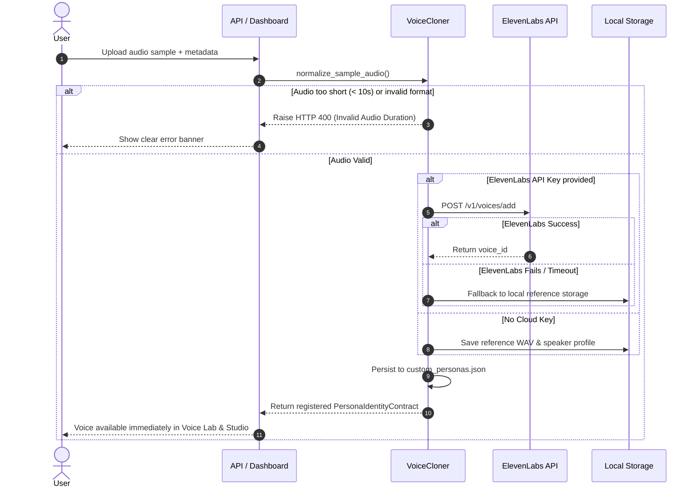

# Low-Level Design (LLD): Custom Voice Cloning & Universal Document Speech Engine

**Project:** Modular-NeuroClips (01_web_applications/Modular-NeuroClips)  
**Author:** Senior Full-Stack & Audio Systems Engineer  
**Version:** 1.0.0  
**Status:** Approved for Implementation  

---

## 1. Class & Data Contract Specifications

### 1.1 Custom Persona Metadata Contract (`src/contracts/persona.py`)

```python
class CustomPersonaRecord(BaseModel):
    """Data model persisted in custom_personas.json for user-cloned voices."""
    persona_id: str = Field(..., pattern=r"^[a-z0-9_]+$", description="Slugified unique persona ID")
    display_name: str
    gender: GenderEnum
    target_locale: RegionLocaleEnum
    demographic_ethnicity: str = "User Cloned"
    industry_domain: str = "Custom Voice / General"
    visual_continuity_anchor: str = "Professional portrait presenter in modern studio"
    canonical_voice: str = "en-IN-NeerjaNeural"  # Fallback Edge-TTS voice
    elevenlabs_voice_id: Optional[str] = None
    reference_audio_path: Optional[str] = None
    default_pitch: str = "+0Hz"
    default_speed: float = 1.0
    created_at_epoch: float
```

### 1.2 Document Parser Contract (`src/document_parser.py`)

```python
class ParsedDocumentScene(BaseModel):
    scene_id: int
    title: str
    narration: str
    word_count: int
    estimated_duration_sec: float

class DocumentParseResult(BaseModel):
    document_title: str
    total_scenes: int
    total_words: int
    scenes: List[ParsedDocumentScene]
```

---

## 2. Component Design & Method Signatures

### 2.1 `VoiceCloner` Engine (`src/agents/voice_cloner.py`)

```python
class VoiceCloner:
    """Handles audio normalization, cloud/local cloning, and catalog registration."""

    def __init__(self, storage_dir: Path, custom_catalog_path: Path):
        self.storage_dir = storage_dir
        self.custom_catalog_path = custom_catalog_path
        self.storage_dir.mkdir(parents=True, exist_ok=True)

    def normalize_sample_audio(self, raw_input_path: Path, output_wav_path: Path) -> Tuple[bool, float, str]:
        """
        Runs FFmpeg to convert raw input audio to 44.1kHz mono WAV,
        applies noise filter, and probes duration.
        Returns: (success, duration_sec, error_message)
        """
        ...

    def clone_voice_elevenlabs(
        self,
        name: str,
        audio_path: Path,
        api_key: str,
        description: Optional[str] = None
    ) -> Tuple[Optional[str], str]:
        """
        Calls ElevenLabs POST https://api.elevenlabs.io/v1/voices/add
        Returns: (voice_id, status_message)
        """
        ...

    def register_custom_persona(
        self,
        name: str,
        gender: GenderEnum,
        locale: RegionLocaleEnum,
        audio_file_bytes: bytes,
        original_filename: str,
        elevenlabs_api_key: Optional[str] = None
    ) -> PersonaIdentityContract:
        """
        Main orchestration method:
        1. Saves and normalizes audio sample.
        2. Clones voice via ElevenLabs or registers local reference.
        3. Persists record in custom_personas.json.
        4. Updates runtime PERSONA_CATALOG in persona.py.
        """
        ...
```

### 2.2 `DocumentParser` Engine (`src/document_parser.py`)

```python
class DocumentParser:
    """Extracts clean narrative text from documents and slices into scenes."""

    @staticmethod
    def extract_text(file_path: Path, mime_type: Optional[str] = None) -> str:
        """Dispatches extraction based on file extension (.txt, .md, .docx, .pdf)."""
        ...

    @staticmethod
    def slice_into_scenes(raw_text: str, target_words_per_scene: int = 60, max_scenes: int = 50) -> DocumentParseResult:
        """
        Splits text on sentence boundaries (period, question mark, newline),
        coalesces sentences into chunks of target_words_per_scene,
        and outputs a DocumentParseResult.
        """
        ...
```

---

## 3. REST API Endpoint Signatures (`src/dashboard.py`)

### 3.1 `POST /api/v1/voice/clone`
- **Content-Type**: `multipart/form-data`
- **Parameters**:
  - `audio_file`: UploadFile (WAV, MP3, OGG, WebM)
  - `display_name`: Form[str]
  - `gender`: Form[str] ("male", "female", "non_binary")
  - `target_locale`: Form[str] ("en-IN", "en-US", "hi-IN", etc.)
  - `elevenlabs_api_key`: Optional[Form[str]]
- **Response (200 OK)**:
  ```json
  {
    "status": "success",
    "persona_id": "srinivas_velaga",
    "display_name": "Srinivas Velaga",
    "voice_id": "21m00Tcm4TlvDq8ikWAM",
    "locale": "en-IN",
    "engine": "elevenlabs"
  }
  ```

### 3.2 `POST /api/v1/voice/synthesize-file`
- **Content-Type**: `multipart/form-data`
- **Parameters**:
  - `document_file`: UploadFile (.txt, .md, .docx, .pdf)
  - `persona_id`: Form[str] (e.g., "srinivas_velaga" or "maya_fintech")
  - `speech_rate`: Optional[Form[float]] = 1.0
  - `pitch`: Optional[Form[str]] = "+0Hz"
  - `export_scorm`: Optional[Form[bool]] = False
- **Response (200 OK)**:
  ```json
  {
    "status": "success",
    "master_audio_url": "/static_renders/master_audio_a1b2c3d4.mp3",
    "subtitles_srt_url": "/static_renders/subtitles_a1b2c3d4.srt",
    "scorm_download_url": "/static_exports/SCORM_DOC_SPEECH_a1b2c3d4.zip",
    "total_scenes": 8,
    "total_duration_sec": 194.2,
    "normalized_lufs": -14.0
  }
  ```

### 3.3 `GET /api/v1/voice/custom-personas`
- **Response (200 OK)**: Returns list of user-cloned personas from `custom_personas.json`.

---

## 4. Error Handling & Failsafe Sequence


